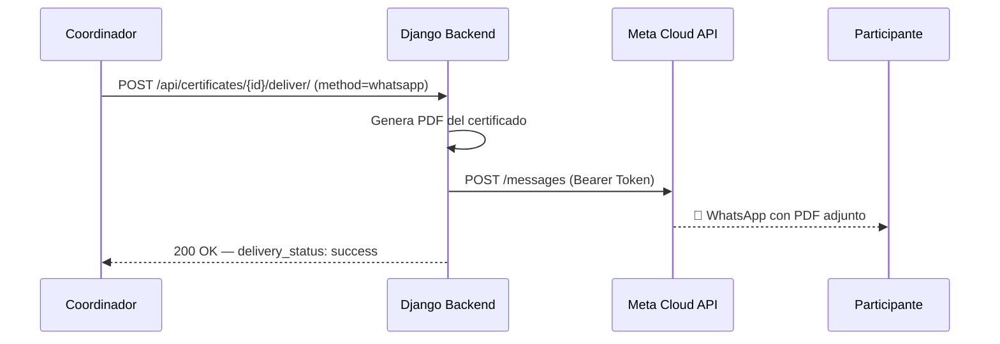
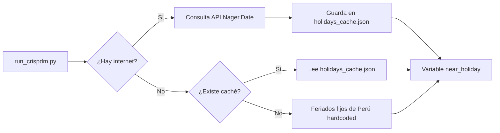

# :fontawesome-solid-plug: Consumo de APIs

!!! info "Requisito 2"
    CertyPro consume **tres APIs externas**, una de las cuales es completamente
    pública, gratuita y sin API key (Nager.Date). Las otras dos se usan para la
    entrega de certificados (email y WhatsApp).

---

## Resumen de APIs integradas

| API | Propósito | Autenticación | Costo |
|---|---|---|---|
| **Nager.Date** | Feriados nacionales (módulo CRISP-DM) | Ninguna (pública) | Gratis |
| **Meta WhatsApp Cloud API** | Envío de certificados por WhatsApp | Bearer Token | Gratuito hasta 1 000 conv./mes |
| **SMTP (Brevo/Gmail)** | Envío de certificados por email | App Password | Gratis |

---

## API 1 — Nager.Date (Feriados Nacionales)

Esta es la API **principal del módulo analítico**. Se usa en la **Fase 3 de CRISP-DM** para enriquecer cada evento con la variable `near_holiday`.

### Detalles del endpoint

```
GET https://date.nager.at/api/v3/PublicHolidays/{año}/{countryCode}
```

| Campo | Valor |
|---|---|
| **Método** | GET |
| **Autenticación** | Ninguna (100 % pública) |
| **Formato** | JSON |
| **País** | `PE` (Perú) |
| **Años consultados** | 2023, 2024, 2025 |

### Respuesta de ejemplo

```json
[
  {
    "date": "2024-01-01",
    "localName": "Año Nuevo",
    "name": "New Year's Day",
    "countryCode": "PE",
    "fixed": true,
    "global": true,
    "counties": null,
    "launchYear": null,
    "types": ["Public"]
  },
  {
    "date": "2024-07-28",
    "localName": "Fiestas Patrias",
    "name": "Independence Day",
    "countryCode": "PE",
    "fixed": true,
    "global": true,
    "counties": null,
    "launchYear": null,
    "types": ["Public"]
  }
]
```

### Resultado en el análisis

!!! example "Evidencia de consumo real"
    Al ejecutar el pipeline CRISP-DM se imprime por consola:
    ```
    [API feriados] PE-2023: 16 feriados (fuente=api)
    [API feriados] PE-2024: 17 feriados (fuente=api)
    [API feriados] PE-2025: 17 feriados (fuente=api)
    ```
    Los datos se cachean en `analytics/outputs/holidays_cache.json` para
    replicabilidad sin conexión a internet.

### Implementación

```python title="analytics/crispdm/holidays_api.py"
import requests

API_BASE = "https://date.nager.at/api/v3/PublicHolidays"

def _fetch_year(year: int, country: str) -> list[str] | None:
    """Consulta la API para un año. Devuelve lista de fechas ISO o None si falla."""
    url = f"{API_BASE}/{year}/{country}"
    try:
        resp = requests.get(url, timeout=8)
        resp.raise_for_status()
        return [item["date"] for item in resp.json()]
    except (requests.RequestException, ValueError):
        return None
```

### Uso en el modelo

La variable `near_holiday` (1 si el evento ocurre a ±2 días de un feriado) resultó ser
la **segunda variable más importante** del modelo predictivo, confirmando la hipótesis:

> *Los eventos cercanos a feriados tienen menor asistencia.*

---

## API 2 — Meta WhatsApp Cloud API

Permite enviar los certificados PDF directamente al número de WhatsApp del participante.

### Flujo de uso



### Configuración

```bash title=".env"
WHATSAPP_PHONE_ID=tu_phone_id
WHATSAPP_ACCESS_TOKEN=tu_bearer_token
WHATSAPP_RECIPIENT_WAID=numero_destino
```

### Código de integración

```python title="services/whatsapp_service.py"
import requests

def send_certificate(certificate, recipient_phone: str) -> dict:
    url = f"https://graph.facebook.com/v18.0/{PHONE_ID}/messages"
    headers = {"Authorization": f"Bearer {ACCESS_TOKEN}"}
    payload = {
        "messaging_product": "whatsapp",
        "to": recipient_phone,
        "type": "document",
        "document": {
            "link": certificate.pdf_url,
            "caption": f"Certificado: {certificate.event.name}"
        }
    }
    resp = requests.post(url, json=payload, headers=headers)
    return {"success": resp.ok, "message": resp.text}
```

---

## API 3 — SMTP (Email)

Integración con proveedores de email para envío de certificados por correo electrónico.

### Configuración

```bash title=".env"
EMAIL_HOST=smtp-relay.brevo.com
EMAIL_PORT=587
EMAIL_HOST_USER=tu_usuario
EMAIL_HOST_PASSWORD=tu_app_password
DEFAULT_FROM_EMAIL=noreply@certypro.com
```

### Flujo

```
Coordinador → POST /deliver/ (method=email)
           → Django EmailService → SMTP Brevo/Gmail
           → Participante recibe email con PDF adjunto
```

---

## Diseño para replicabilidad (Nager.Date)



!!! tip "Sin excusas para no reproducir"
    El pipeline CRISP-DM **siempre corre**, sin importar si hay conexión a internet.
    Usa `--offline` para forzar el modo sin red:
    ```bash
    python run_crispdm.py --offline
    ```
