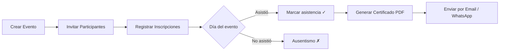
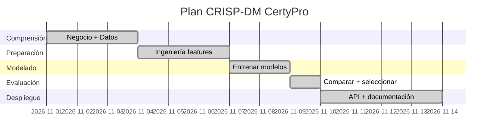

# :fontawesome-solid-briefcase: Fase 1 — Comprensión del Negocio

!!! abstract "Objetivo de esta fase"
    Definir el problema desde la perspectiva del negocio, establecer los objetivos
    de minería de datos y los criterios de éxito.

---

## 1.1 Contexto organizacional

**CertyPro** es un sistema de gestión de certificados utilizado por instituciones
que realizan eventos de capacitación: talleres, cursos, seminarios y conferencias.

El ciclo operativo del sistema es:

---

## 1.2 Problema identificado

### Ausentismo en eventos

!!! warning "Problema de negocio"
    Entre el **30 % y el 50 %** de los inscritos en eventos de capacitación
    **no asisten**, generando:

    - Exceso de materiales impresos/preparados
    - Aforo reservado sin uso (costos logísticos)
    - Certificados pre-generados inútilmente
    - Dificultad para ajustar recursos a tiempo real

### Situación actual

Hoy no existe ningún mecanismo predictivo. El coordinador se entera del ausentismo
**el mismo día del evento**, cuando ya no hay tiempo para actuar.

---

## 1.3 Objetivo del negocio

> **Reducir el ausentismo en eventos de capacitación gestionados por CertyPro,
> optimizando la logística y los recordatorios dirigidos.**

### Acciones habilitadas por el modelo predictivo

| Predicción | Acción posible |
|---|---|
| Alta probabilidad de **no asistencia** | Enviar recordatorio personalizado 24-48 h antes |
| Estimación del **aforo real** | Ajustar materiales y catering a la asistencia esperada |
| Lista de **alto riesgo** | Confirmar telefónicamente o liberar cupo a lista de espera |

---

## 1.4 Objetivo de minería de datos

> **Predecir si un participante inscrito en un evento de CertyPro asistirá o no**
> (clasificación binaria: `attended = 1` ó `attended = 0`).

### Variables disponibles en el momento de la predicción

!!! note "Sin fuga de información"
    Solo se usan variables conocidas **antes** del evento, respetando la integridad
    del modelo predictivo (no se incluye `grade`, `certificate_sent`, etc.).

| Variable | Tipo | Disponible antes del evento |
|---|---|:---:|
| Días de anticipación de la inscripción | Numérica | ✅ |
| Duración del evento (horas) | Numérica | ✅ |
| Capacidad máxima del evento | Numérica | ✅ |
| ¿El evento es público? | Binaria | ✅ |
| Categoría del evento | Categórica | ✅ |
| Día de la semana del evento | Numérica | ✅ |
| Mes del evento | Numérica | ✅ |
| ¿Cae cerca de un feriado? (API Nager.Date) | Binaria | ✅ |
| ¿Hubo invitación formal? | Binaria | ✅ |
| ¿Aceptó la invitación? | Binaria | ✅ |
| Nº de eventos previos del participante | Numérica | ✅ |
| Tasa de asistencia histórica del participante | Numérica | ✅ |

---

## 1.5 Criterios de éxito

### Criterio de negocio
Que el sistema pueda **priorizar al menos el 70 % de los futuros ausentes** para
enviarles recordatorios, antes de que ocurra el evento.

### Criterio técnico (minería de datos)

| Métrica | Umbral mínimo | Justificación |
|---|---|---|
| **ROC-AUC (CV 5 folds)** | **≥ 0.75** | Métrica robusta ante desbalance de clases |
| **F1-Score** | ≥ 0.70 | Balance entre precisión y recall |
| **Recall (clase 0 = ausente)** | ≥ 0.65 | Priorizar capturar los ausentes |

!!! success "Resultado obtenido"
    CV ROC-AUC = **0.764** → criterio técnico **ALCANZADO**.

---

## 1.6 Plan del proyecto

