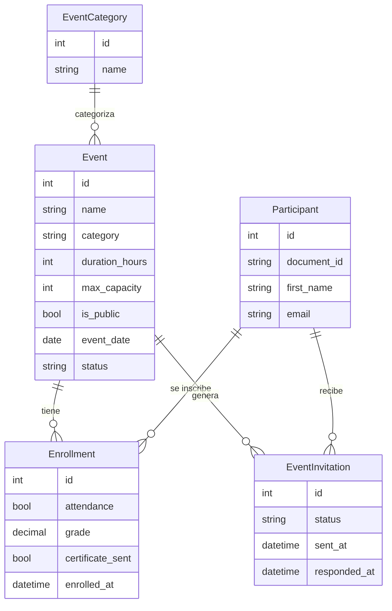

# :fontawesome-solid-database: Fase 2 — Comprensión de los Datos

!!! abstract "Objetivo de esta fase"
    Identificar las fuentes de datos disponibles, explorar su estructura y
    calidad, y detectar variables relevantes para el problema de negocio.

---

## 2.1 Fuentes de datos

Los datos provienen del modelo de dominio de CertyPro — la base de datos
PostgreSQL que ya usa el sistema en producción.



---

## 2.2 Unidad de análisis

**Una fila del dataset = una inscripción** (`Enrollment`):

> *Un participante `P` inscrito en el evento `E`, con la etiqueta de si asistió o no.*

---

## 2.3 Descripción de la variable objetivo

| Variable | Tipo | Valores | Significado |
|---|---|---|---|
| `attended` | Binaria | 0 / 1 | 0 = No asistió, 1 = Asistió |

**Distribución en la corrida de referencia (1 836 inscripciones):**

| Clase | Conteo | Porcentaje |
|:---:|:---:|:---:|
| 0 (No asistió) | 888 | 48.4 % |
| 1 (Asistió) | 948 | 51.6 % |

!!! success "Clases balanceadas"
    La distribución casi 50/50 facilita el entrenamiento de modelos de clasificación
    sin necesidad de técnicas de balanceo (SMOTE, undersampling, etc.).

---

## 2.4 Exploración de datos

### Estadísticas descriptivas

| Variable | Media | Desv. Est. | Min | Max |
|---|:---:|:---:|:---:|:---:|
| `duration_hours` | 17.9 | 13.4 | 4 | 40 |
| `max_capacity` | 55.1 | 36.4 | 20 | 120 |
| `lead_time_days` | 22.0 | 13.0 | 0 | 44 |
| `participant_prior_rate` | 0.504 | 0.243 | 0 | 1 |

### Asistencia por categoría de evento

| Categoría | Tasa de asistencia |
|---|:---:|
| Finanzas | ~58 % |
| Salud | ~56 % |
| Tecnología | ~54 % |
| Gestión | ~51 % |
| Educación | ~49 % |
| Idiomas | ~44 % |

### Efecto de los feriados

!!! example "Hipótesis confirmada por la API"
    Eventos **cerca de un feriado** (variable `near_holiday` obtenida de la API Nager.Date):

    | Feriado cercano | Tasa de asistencia |
    |:---:|:---:|
    | No (0) | ~56 % |
    | Sí (1) | ~31 % |

    La diferencia de **~25 puntos porcentuales** hace de esta variable una de las más
    importantes del modelo.

---

## 2.5 Calidad de los datos

| Aspecto | Estado |
|---|---|
| **Valores faltantes** | Mínimos: `duration_hours` y `max_capacity` pueden ser 0/null → se rellenan con 0 |
| **Duplicados** | La restricción `unique_together = (participant, event)` en `Enrollment` garantiza que no hay duplicados |
| **Leakage** | Controlado: se excluyen variables posteriores al evento (`grade`, `certificate_sent`, `certificate_sent_at`) |
| **Consistencia temporal** | El historial del participante se calcula solo con eventos anteriores a la fecha del evento actual |

---

## 2.6 Modos de datos

!!! note "Dos fuentes para máxima flexibilidad"

=== "Datos reales (ORM Django)"
    ```python
    from analytics.crispdm.data_source import load_raw
    df, source = load_raw(prefer_orm=True)
    # source = "orm"
    ```
    Lee directamente de la base de datos PostgreSQL de CertyPro. Requiere la BD poblada.

=== "Datos sintéticos (replicabilidad)"
    ```python
    df, source = load_raw(prefer_orm=False)
    # source = "synthetic"
    ```
    Genera 1 836 inscripciones con una semilla fija (42). La asistencia se simula con
    un modelo logístico latente sobre variables observables:

    ```python
    z = (
        -0.3
        + 1.0 * (reliability[pid] - 0.5)   # fiabilidad del participante
        + 0.055 * lead_time_days             # anticipación de la inscripción
        - 0.05 * duration_hours              # eventos más largos → menor asistencia
        - 1.5 * is_holiday                   # cerca de feriado → menor asistencia
        + 1.1 * invitation_accepted          # aceptó invitación → mayor asistencia
        + 0.6 * is_public                    # evento público
    )
    attendance = random() < sigmoid(z)
    ```
    Garantiza que la señal sea real y aprendible, y que los resultados sean reproducibles.
