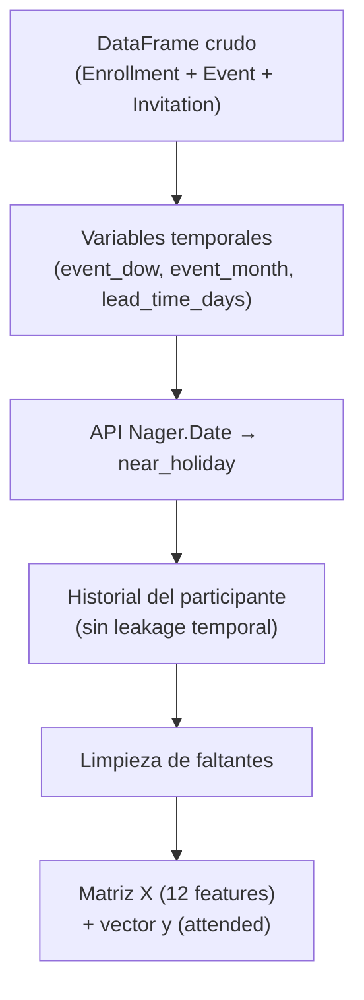

# :fontawesome-solid-wrench: Fase 3 — Preparación de los Datos

!!! abstract "Objetivo de esta fase"
    Transformar los datos crudos en la matriz de características lista para el modelado:
    derivar variables temporales, enriquecer con la API de feriados, construir el
    historial del participante y limpiar valores faltantes.

---

## 3.1 Resumen del proceso



---

## 3.2 Variables derivadas

### Variables temporales

Derivadas de las fechas disponibles antes del evento:

```python title="analytics/crispdm/features.py"
df["event_dow"]      = df["event_date"].dt.dayofweek   # 0=lunes … 6=domingo
df["event_month"]    = df["event_date"].dt.month
df["lead_time_days"] = (df["event_date"] - df["enrolled_at"]).dt.days.clip(lower=0)
```

| Variable | Descripción | Hipótesis |
|---|---|---|
| `event_dow` | Día de la semana (0=lunes) | Eventos el lunes/viernes tienen menor asistencia |
| `event_month` | Mes del año | Meses de vacaciones → menor asistencia |
| `lead_time_days` | Días de anticipación de la inscripción | Mayor anticipación → mayor compromiso |

### Enriquecimiento con API externa (Nager.Date)

!!! tip "Consumo de API — Requisito 2"
    La variable `near_holiday` se obtiene consultando la **API pública Nager.Date**
    para los feriados nacionales de Perú.

```python title="analytics/crispdm/holidays_api.py"
def get_holiday_dates(years, country="PE", *, use_network=True) -> set[date]:
    for year in years:
        # 1. Consulta la API
        iso_dates = _fetch_year(year, country)   # GET date.nager.at/api/v3/...
        # 2. Si falla, usa caché local
        if iso_dates is None:
            iso_dates = cache.get(f"{country}-{year}")
        # 3. Último recurso: feriados fijos hardcoded
        if iso_dates is None:
            iso_dates = _fallback_dates(year)
```

```python title="analytics/crispdm/features.py"
holidays = get_holiday_dates(years=years, use_network=True)

def is_near(d: date) -> int:
    for delta in range(-2, 3):        # ventana de ±2 días
        if (d + timedelta(days=delta)) in holidays:
            return 1
    return 0

df["near_holiday"] = [is_near(d) for d in df["event_date"]]
```

### Historial del participante (sin data leakage)

!!! warning "Integridad temporal"
    Para evitar fuga de información, el historial de cada participante se calcula
    **solo con inscripciones anteriores** a la fecha del evento evaluado.

```python
df = df.sort_values("event_date")  # orden cronológico
seen_counts = {}
seen_attended = {}

for _, row in df.iterrows():
    pid = row["participant_id"]
    c = seen_counts.get(pid, 0)
    a = seen_attended.get(pid, 0)

    # Solo eventos ANTERIORES al actual
    row["participant_prior_events"] = c
    row["participant_prior_rate"]   = a / c if c > 0 else 0.5

    # Actualizar acumulados
    seen_counts[pid]   = c + 1
    seen_attended[pid] = a + int(row["attended"])
```

---

## 3.3 Matriz de características final

| # | Variable | Tipo | Preprocesamiento |
|:---:|---|---|---|
| 1 | `duration_hours` | Numérica | StandardScaler |
| 2 | `max_capacity` | Numérica | StandardScaler |
| 3 | `lead_time_days` | Numérica | StandardScaler |
| 4 | `participant_prior_events` | Numérica | StandardScaler |
| 5 | `participant_prior_rate` | Numérica | StandardScaler |
| 6 | `event_dow` | Numérica | StandardScaler |
| 7 | `event_month` | Numérica | StandardScaler |
| 8 | `is_public` | Binaria | passthrough |
| 9 | `near_holiday` | Binaria (**API**) | passthrough |
| 10 | `was_invited` | Binaria | passthrough |
| 11 | `invitation_accepted` | Binaria | passthrough |
| 12 | `category` | Categórica | OneHotEncoder |

**Dimensiones finales:** 1 836 × 12 (antes de one-hot) → 1 836 × 17 (después de one-hot para 6 categorías).

---

## 3.4 Variables excluidas (anti-leakage)

| Variable excluida | Razón |
|---|---|
| `grade` | Solo se conoce después del evento |
| `certificate_sent` | Solo ocurre si el participante asistió |
| `certificate_sent_at` | Posterior al evento |
| `attendance` | Es la variable objetivo, no puede ser feature |
| `status (Enrollment)` | Puede cambiar después del evento |

---

## 3.5 Implementación completa

```python title="analytics/crispdm/features.py"
from .holidays_api import get_holiday_dates

def build_feature_matrix(raw, *, use_network=True):
    df = raw.copy()
    df["event_date"]   = pd.to_datetime(df["event_date"])
    df["enrolled_at"]  = pd.to_datetime(df["enrolled_at"])

    # Variables temporales
    df["event_dow"]      = df["event_date"].dt.dayofweek
    df["event_month"]    = df["event_date"].dt.month
    df["lead_time_days"] = (df["event_date"] - df["enrolled_at"]).dt.days.clip(lower=0)

    # Enriquecimiento con API de feriados
    years = tuple(sorted(df["event_date"].dt.year.unique()))
    holidays = get_holiday_dates(years=years, use_network=use_network)
    df = _add_holiday_flag(df, holidays)

    # Historial del participante (sin leakage)
    df = _add_participant_history(df)

    # Limpieza
    for col in ["duration_hours", "max_capacity", "lead_time_days"]:
        df[col] = pd.to_numeric(df[col], errors="coerce").fillna(0)

    X = df[FEATURE_COLUMNS]
    y = df["attended"].astype(int)
    return X, y, df
```
