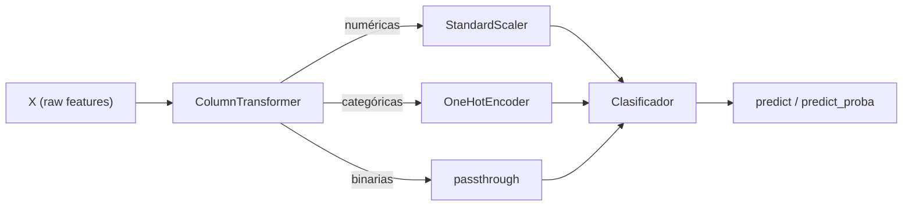

# :fontawesome-solid-robot: Fase 4 — Modelado

!!! abstract "Objetivo de esta fase"
    Seleccionar y entrenar los algoritmos de clasificación binaria, construyendo
    pipelines con preprocesamiento integrado para evitar fuga de datos entre
    entrenamiento y prueba.

---

## 4.1 Estrategia de partición

```python
from sklearn.model_selection import train_test_split

X_train, X_test, y_train, y_test = train_test_split(
    X, y,
    test_size=0.25,          # 75 % train, 25 % test
    random_state=42,         # semilla fija (reproducibilidad)
    stratify=y               # misma proporción de clases en ambas particiones
)
```

| Conjunto | Filas | Proporción |
|---|:---:|:---:|
| **Entrenamiento** | 1 377 | 75 % |
| **Prueba (holdout)** | 459 | 25 % |

**Validación cruzada:** 5 folds estratificados sobre el conjunto de entrenamiento completo.

---

## 4.2 Pipeline de scikit-learn

Cada modelo se envuelve en un `Pipeline` con preprocesamiento:



```python title="analytics/crispdm/model.py"
from sklearn.compose import ColumnTransformer
from sklearn.pipeline import Pipeline
from sklearn.preprocessing import StandardScaler, OneHotEncoder

preprocessor = ColumnTransformer([
    ("num", StandardScaler(),              NUMERIC_FEATURES),
    ("cat", OneHotEncoder(handle_unknown="ignore"), CATEGORICAL_FEATURES),
], remainder="passthrough")  # binarias pasan sin transformar
```

!!! note "¿Por qué Pipeline?"
    Con `Pipeline`, el `StandardScaler` **solo aprende la media/desviación del conjunto de entrenamiento**
    y la aplica al de prueba — se elimina el riesgo de leakage de preprocesamiento.

---

## 4.3 Modelos entrenados

=== "Regresión Logística"
    **Modelo lineal interpretable** — baseline clásico en clasificación binaria.

    ```python
    from sklearn.linear_model import LogisticRegression

    Pipeline([
        ("pre", preprocessor),
        ("clf", LogisticRegression(
            max_iter=1000,
            random_state=42
        ))
    ])
    ```

    **Ventajas:**
    - Totalmente interpretable (coeficientes = importancia de cada variable)
    - Rápido de entrenar
    - Robusto con pocas muestras

    **Limitaciones:**
    - Supone relaciones lineales entre features y log-odds

=== "Random Forest"
    **Ensamble de árboles de decisión** — captura interacciones no lineales.

    ```python
    from sklearn.ensemble import RandomForestClassifier

    Pipeline([
        ("pre", preprocessor),
        ("clf", RandomForestClassifier(
            n_estimators=300,
            max_depth=12,
            min_samples_leaf=5,
            random_state=42,
            n_jobs=-1       # usa todos los núcleos
        ))
    ])
    ```

    **Ventajas:**
    - Captura interacciones complejas entre variables
    - Importancia de variables nativa
    - Robusto ante outliers

    **Limitaciones:**
    - Menos interpretable que Logística
    - Más lento de entrenar

---

## 4.4 Métricas de evaluación elegidas

| Métrica | Fórmula | Justificación |
|---|---|---|
| **ROC-AUC** | Área bajo la curva ROC | Principal: robusta ante desbalance, no depende del umbral |
| **F1-Score** | 2 × (P × R) / (P + R) | Balance entre precisión y recall |
| **Accuracy** | Correctos / Total | Referencia general |
| **Precision** | VP / (VP + FP) | Evitar falsos recordatorios |
| **Recall** | VP / (VP + FN) | No perder ausentes reales |
| **CV ROC-AUC** | Media de 5 folds | Generalización (criterio de éxito) |

!!! tip "¿Por qué ROC-AUC y no Accuracy?"
    La **Accuracy** puede ser engañosa con clases casi balanceadas (un modelo que siempre
    predice "asistirá" tiene ~52 % de accuracy). El **ROC-AUC** mide la capacidad real de
    discriminación del modelo en todos los umbrales posibles.

---

## 4.5 Código de entrenamiento completo

```python title="analytics/crispdm/model.py"
from sklearn.model_selection import cross_val_score
from sklearn.metrics import roc_auc_score, f1_score, accuracy_score

results = {}
fitted = {}

for name, pipe in _build_models().items():
    # Entrenamiento
    pipe.fit(X_train, y_train)

    # Predicción en holdout
    y_pred  = pipe.predict(X_test)
    y_proba = pipe.predict_proba(X_test)[:, 1]

    # Validación cruzada
    cv = cross_val_score(pipe, X, y, cv=5, scoring="roc_auc")

    results[name] = {
        "roc_auc":          roc_auc_score(y_test, y_proba),
        "f1":               f1_score(y_test, y_pred),
        "accuracy":         accuracy_score(y_test, y_pred),
        "cv_roc_auc_mean":  cv.mean(),
        "cv_roc_auc_std":   cv.std(),
    }
    fitted[name] = pipe

# Selección del ganador por ROC-AUC en holdout
best_name  = max(results, key=lambda n: results[n]["roc_auc"])
best_model = fitted[best_name]

# Persistir el modelo ganador
import joblib
joblib.dump(best_model, "analytics/models/attendance_model.joblib")
```
