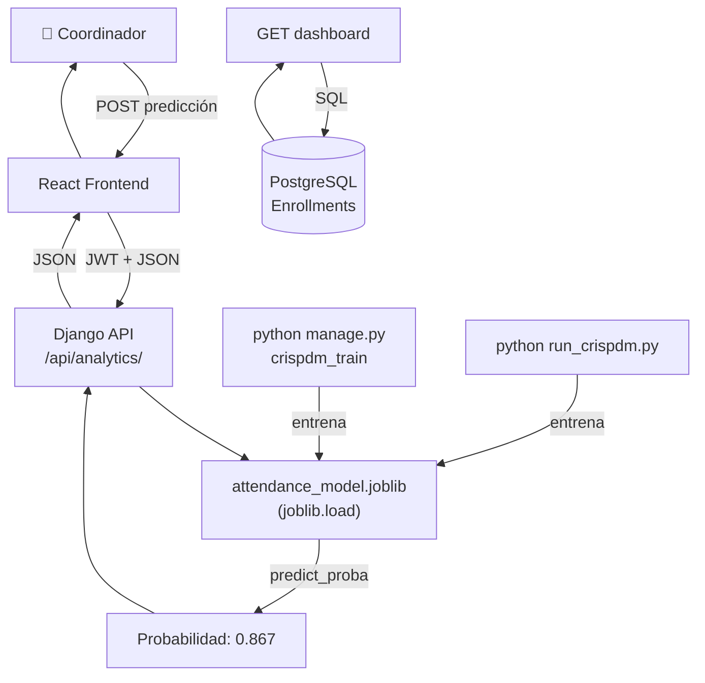

# :fontawesome-solid-rocket: Fase 6 — Despliegue

!!! abstract "Objetivo de esta fase"
    Integrar el modelo entrenado al sistema CertyPro como endpoints REST,
    exponer la analítica descriptiva y hacer el modelo accesible para los
    coordinadores desde la misma interfaz del sistema.

---

## 6.1 Arquitectura del despliegue



---

## 6.2 Endpoints expuestos

Registrados en `analytics/urls.py` bajo el prefijo `/api/analytics/`:

### GET `/api/analytics/dashboard/`

Estadísticas descriptivas de asistencia calculadas sobre los datos reales.

**Respuesta:**
```json
{
  "source": "orm",
  "total_enrollments": 1836,
  "unique_participants": 449,
  "unique_events": 70,
  "global_attendance_rate": 0.516,
  "attendance_by_category": {
    "Finanzas": 0.581,
    "Salud": 0.562,
    "Tecnologia": 0.541,
    "Gestion": 0.512,
    "Educacion": 0.489,
    "Idiomas": 0.441
  },
  "attendance_by_month": { ... }
}
```

---

### GET `/api/analytics/model-info/`

Métricas del último entrenamiento (leídas de `outputs/metrics.json`).

**Respuesta:**
```json
{
  "best_model_name": "logistic_regression",
  "results": {
    "logistic_regression": {
      "roc_auc": 0.806,
      "f1": 0.825,
      "accuracy": 0.767,
      "cv_roc_auc_mean": 0.764
    },
    "random_forest": { ... }
  },
  "feature_importances": [
    {"feature": "remainder__invitation_accepted", "importance": 0.3821},
    {"feature": "remainder__near_holiday",        "importance": 0.2914},
    ...
  ]
}
```

---

### POST `/api/analytics/predict-attendance/`

Predice la probabilidad de asistencia para una inscripción.

**Cuerpo (JSON):**
```json
{
  "duration_hours": 8,
  "max_capacity": 50,
  "is_public": 1,
  "category": "Tecnologia",
  "event_dow": 2,
  "event_month": 7,
  "lead_time_days": 20,
  "near_holiday": 0,
  "was_invited": 1,
  "invitation_accepted": 1,
  "participant_prior_events": 3,
  "participant_prior_rate": 0.8
}
```

**Respuesta:**
```json
{
  "will_attend": true,
  "attendance_probability": 0.867,
  "risk_level": "bajo",
  "recommendation": "Sin accion requerida"
}
```

| `risk_level` | Rango de probabilidad | `recommendation` |
|:---:|---|---|
| `alto` | < 0.40 | Enviar recordatorio prioritario |
| `medio` | 0.40 – 0.70 | Seguimiento normal |
| `bajo` | > 0.70 | Sin acción requerida |

---

## 6.3 Reentrenamiento del modelo

=== "Vía Django (producción)"
    ```bash
    # Datos reales de la BD (si hay suficientes)
    python manage.py crispdm_train

    # Forzar datos sintéticos (siempre reproducible)
    python manage.py crispdm_train --synthetic --offline
    ```

=== "Vía script standalone"
    ```bash
    cd SystemCertification/analytics
    python run_crispdm.py          # con API de feriados
    python run_crispdm.py --offline  # sin internet
    ```

---

## 6.4 Código de las vistas

```python title="analytics/views.py"
class PredictAttendanceView(APIView):
    permission_classes = [permissions.IsAuthenticated]

    def post(self, request):
        model = load_model()   # carga attendance_model.joblib

        payload = {**self._defaults, **(request.data or {})}
        X = pd.DataFrame([payload], columns=FEATURE_COLUMNS)

        proba = float(model.predict_proba(X)[0, 1])
        pred  = int(proba >= 0.5)

        return Response({
            "will_attend":              bool(pred),
            "attendance_probability":   round(proba, 4),
            "risk_level":               "alto" if proba < 0.4 else
                                        ("medio" if proba < 0.7 else "bajo"),
            "recommendation":           "Enviar recordatorio prioritario" if proba < 0.4 else
                                        "Seguimiento normal" if proba < 0.7 else
                                        "Sin accion requerida",
        })
```

---

## 6.5 Integración en settings.py y urls.py

```python title="config/settings.py"
INSTALLED_APPS = [
    ...
    "analytics",   # app de analítica CRISP-DM
]
```

```python title="config/urls.py"
urlpatterns = [
    ...
    path("api/analytics/", include("analytics.urls")),
]
```

---

## 6.6 Ejemplo con curl

```bash
# Autenticarse primero
TOKEN=$(curl -s -X POST http://localhost:8000/api/login/ \
  -H "Content-Type: application/json" \
  -d '{"email":"admin@certypro.com","password":"admin123"}' | python -c "import sys,json;print(json.load(sys.stdin)['access'])")

# Predecir asistencia
curl -X POST http://localhost:8000/api/analytics/predict-attendance/ \
  -H "Authorization: Bearer $TOKEN" \
  -H "Content-Type: application/json" \
  -d '{
    "duration_hours": 8, "lead_time_days": 20,
    "invitation_accepted": 1, "is_public": 1,
    "near_holiday": 0, "category": "Tecnologia"
  }'
```

**Salida:**
```json
{"will_attend": true, "attendance_probability": 0.867, "risk_level": "bajo"}
```
