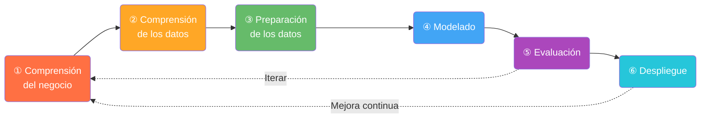

# :fontawesome-solid-chart-line: Metodología CRISP-DM

!!! info "Requisito 3"
    Se aplica la metodología **CRISP-DM** (*Cross Industry Standard Process for Data Mining*)
    al sistema CertyPro, implementando las 6 fases de forma completa y reproducible.

---

## ¿Qué es CRISP-DM?

**CRISP-DM** es el estándar de facto para proyectos de minería de datos y ciencia de datos.
Define un proceso iterativo de 6 fases que guía desde la comprensión del negocio hasta
el despliegue del modelo en producción.



---

## Problema de negocio

En los eventos de capacitación gestionados por CertyPro existe **ausentismo**:
personas que se inscriben pero no asisten. Esto implica:

- Desperdicio de **aforo** reservado (sillas, equipos, materiales)
- Distorsión en la **emisión de certificados** (se esperan participantes que no llegan)
- Dificultad para **planificar recursos** (catering, instructores, infraestructura)

**Solución propuesta:** predecir con antelación si un inscrito asistirá o no, para
tomar acciones preventivas (recordatorios, confirmaciones, ajuste de aforo).

---

## Resumen de resultados

| Métrica | Valor |
|---|---|
| **Modelo ganador** | Regresión Logística |
| **ROC-AUC (holdout)** | **0.806** |
| **F1-Score** | **0.825** |
| **Accuracy** | 0.767 |
| **CV ROC-AUC (5 folds)** | **0.764** ✅ |
| **Meta (CV-AUC ≥ 0.75)** | **ALCANZADA** |

!!! success "Variable más influyente"
    `invitation_accepted` (aceptar la invitación formal) → mayor probabilidad de asistencia.
    `near_holiday` (evento cerca de feriado) → segunda variable más importante (API externa).

---

## Navegación por fases

| Fase | Nombre | Archivo |
|:---:|---|---|
| **1** | Comprensión del negocio | [→ Fase 1](fase1-negocio.md) |
| **2** | Comprensión de los datos | [→ Fase 2](fase2-datos.md) |
| **3** | Preparación de los datos | [→ Fase 3](fase3-preparacion.md) |
| **4** | Modelado | [→ Fase 4](fase4-modelado.md) |
| **5** | Evaluación | [→ Fase 5](fase5-evaluacion.md) |
| **6** | Despliegue | [→ Fase 6](fase6-despliegue.md) |

---

## Código del módulo

Todo el código está en `SystemCertification/analytics/crispdm/`:

```
analytics/
├── crispdm/
│   ├── config.py         ← semilla, rutas, variables del modelo
│   ├── data_source.py    ← datos reales (ORM) o sintéticos
│   ├── holidays_api.py   ← API Nager.Date (feriados)
│   ├── features.py       ← ingeniería de variables (Fase 3)
│   ├── model.py          ← entrenamiento y evaluación (Fases 4-5)
│   └── pipeline.py       ← orquestador de las 6 fases + gráficos
├── run_crispdm.py        ← runner standalone (replicabilidad)
└── requirements-analytics.txt
```
