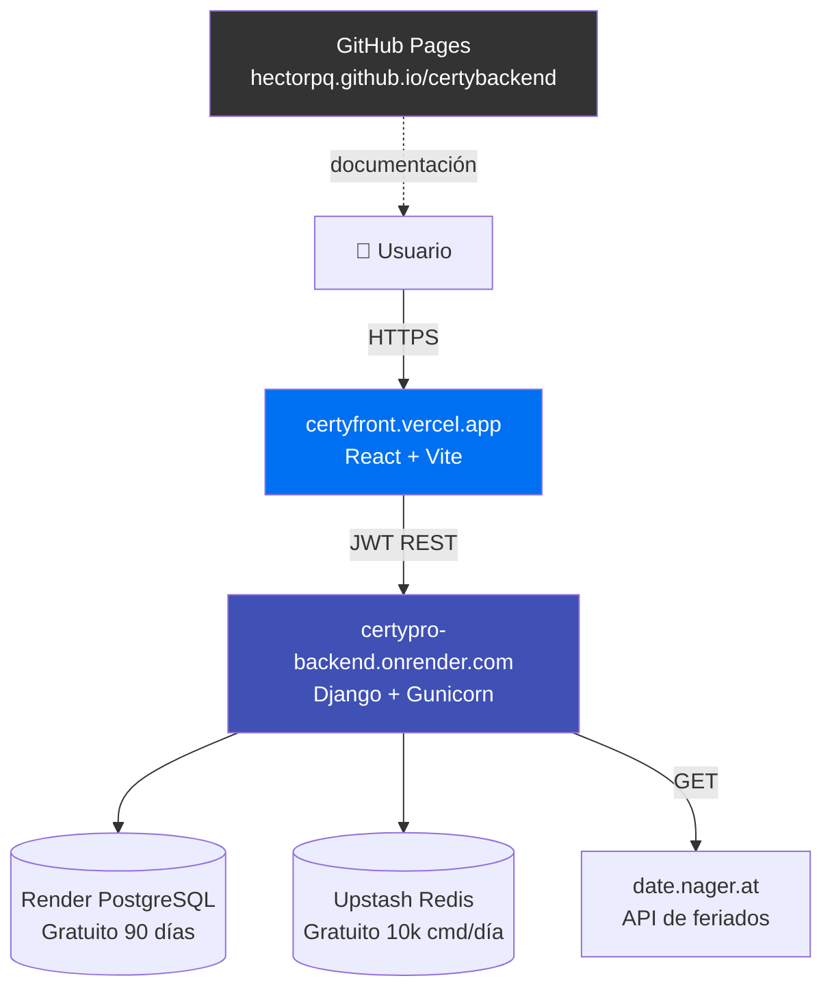

# :fontawesome-solid-cloud: Despliegue en la nube (100 % gratis)

!!! success "URLs del sistema en producción"
    - **Backend API:** `https://certypro-backend.onrender.com`
    - **API Docs:** `https://certypro-backend.onrender.com/api/docs/`
    - **Frontend:** `https://certyfront.vercel.app`
    - **Documentación:** `https://hectorpq.github.io/certybackend/`

---

## Arquitectura de producción



---

## Paso 1 — Backend en Render.com

### Opción A: Usando render.yaml (recomendada)

El repositorio ya incluye `SystemCertification/render.yaml` con toda la infraestructura declarada.

1. Ir a **[dashboard.render.com](https://dashboard.render.com)** → **New** → **Blueprint**
2. Conectar el repositorio **`hectorpq/certybackend`**
3. Render detecta `render.yaml` y crea automáticamente:
   - Web Service (backend Django)
   - Base de datos PostgreSQL

!!! warning "Variables a completar en el dashboard"
    Tras crear el blueprint, ir a **certypro-backend → Environment** y agregar:

    | Variable | Valor |
    |---|---|
    | `REDIS_URL` | URL de Upstash Redis (ver Paso 2) |
    | `EMAIL_HOST_USER` | Tu usuario SMTP de Brevo |
    | `EMAIL_HOST_PASSWORD` | Tu contraseña SMTP de Brevo |

### Opción B: Manual

1. **New Web Service** → conectar repositorio → seleccionar directorio `SystemCertification`
2. **Runtime:** Docker
3. **Plan:** Free

### Variables de entorno críticas

| Variable | Valor en Render |
|---|---|
| `DEBUG` | `False` |
| `DATABASE_URL` | Render la inyecta automáticamente |
| `SECRET_KEY` | Render puede generarla (Generate value) |
| `ALLOWED_HOSTS` | `certypro-backend.onrender.com` |
| `REDIS_URL` | URL de Upstash (siguiente sección) |

---

## Paso 2 — Redis gratuito con Upstash

Render no ofrece Redis gratuito, pero **[Upstash](https://upstash.com)** sí:

1. Crear cuenta en **upstash.com**
2. **Create Database** → tipo **Redis** → región **us-east-1**
3. Copiar la **Redis URL** (formato `rediss://...@...upstash.io:...`)
4. Pegar en Render como variable `REDIS_URL`

!!! note "Plan gratuito Upstash"
    - 10 000 comandos / día
    - 256 MB de datos
    - Suficiente para Celery + caché de CertyPro

---

## Paso 3 — Frontend en Vercel

El frontend ya tiene `vercel.json` configurado.

1. Ir a **[vercel.com](https://vercel.com)** → **New Project**
2. Importar repositorio `hectorpq/certybackend`
3. **Root Directory:** `frontcerty`
4. **Build Command:** `npm run build`
5. **Output Directory:** `dist`
6. Agregar variable de entorno:

    | Variable | Valor |
    |---|---|
    | `VITE_API_URL` | `https://certypro-backend.onrender.com` |

7. Hacer deploy → Vercel asigna URL `certypro-frontend.vercel.app`

---

## Paso 4 — Documentación en GitHub Pages

La documentación se despliega automáticamente:

1. Habilitar GitHub Pages en el repositorio:
   - **Settings** → **Pages** → **Source: GitHub Actions**
2. Hacer `git push` a `main` con los archivos de docs
3. GitHub Actions ejecuta `.github/workflows/deploy-docs.yml`
4. El sitio queda disponible en `https://hectorpq.github.io/certybackend/`

!!! tip "Deploy manual"
    ```bash
    pip install -r requirements-docs.txt
    mkdocs gh-deploy --force
    ```

---

## Verificación post-deploy

```bash
# Backend health check
curl https://certypro-backend.onrender.com/api/schema/

# Predicción de asistencia (con token)
curl -X POST https://certypro-backend.onrender.com/api/analytics/predict-attendance/ \
  -H "Authorization: Bearer <TOKEN>" \
  -H "Content-Type: application/json" \
  -d '{"duration_hours":8,"invitation_accepted":1,"near_holiday":0}'
```

---

## Resumen de costos

| Servicio | Plan | Costo |
|---|---|:---:|
| Render Web Service (backend) | Free | **$0** |
| Render PostgreSQL | Free (90 días) | **$0** |
| Upstash Redis | Free | **$0** |
| Vercel (frontend) | Hobby | **$0** |
| GitHub Pages (documentación) | Free | **$0** |
| **Total** | | **$0 / mes** |
