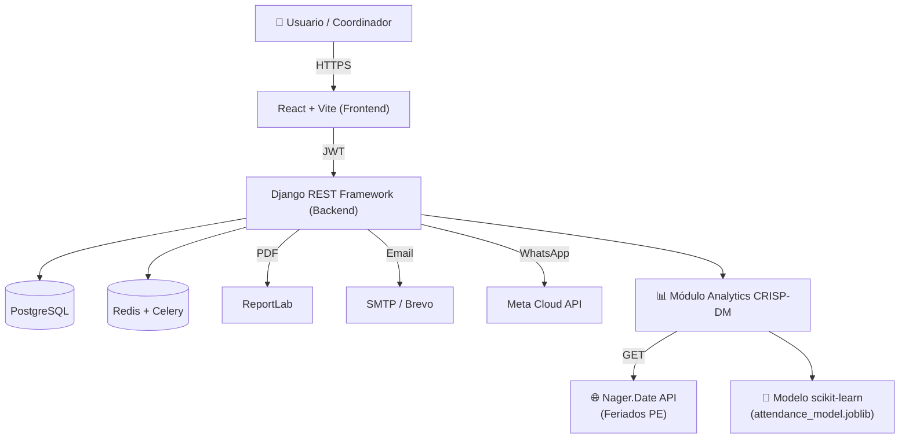

# :fontawesome-solid-certificate: CertyPro — Sistema de Gestión de Certificados

<div style="text-align:center;margin-bottom:2rem;">
  
  <p style="color:#666;font-size:1.05rem;margin-top:.5rem;">
    Sistema web para gestionar eventos de capacitación, inscripciones, asistencia y emisión de certificados digitales con análisis predictivo.
  </p>
</div>

---

## ¿Qué es CertyPro?

**CertyPro** automatiza la emisión, personalización y distribución de certificados académicos. Diseñado para instituciones educativas y organizadores de eventos, cubre todo el ciclo: desde la creación del evento hasta la generación del PDF con código QR y la entrega por email, WhatsApp o enlace público.

Además incorpora un módulo de **analítica predictiva** basado en la metodología **CRISP-DM** que predice la asistencia de cada participante y permite tomar decisiones proactivas.

```
Evento → Inscripción → Asistencia → Certificado → Envío (Email / WhatsApp)
```

---

## Cumplimiento de requisitos

| # | Requisito | Estado |
|:---:|---|:---:|
| 1 | **Sistema libre** — 100 % open-source, sin licencias de pago | :white_check_mark: |
| 2 | **Consumo de APIs** — API pública Nager.Date (feriados) + WhatsApp Cloud API + SMTP | :white_check_mark: |
| 3 | **Metodología CRISP-DM** — 6 fases implementadas y documentadas | :white_check_mark: |
| 4 | **Presentación + Replicabilidad** — pipeline reproducible con un único comando | :white_check_mark: |

---

## Arquitectura del sistema



---

## Stack tecnológico

=== "Backend"

    | Tecnología | Versión | Rol |
    |---|---|---|
    | Python | 3.10 | Lenguaje principal |
    | Django | 5.2 | Framework web |
    | Django REST Framework | 3.14 | API REST |
    | PostgreSQL | 15 | Base de datos |
    | Redis + Celery | 7 / 5 | Cola de tareas async |
    | ReportLab | 4.0 | Generación de PDFs |
    | simplejwt | 5.3 | Autenticación JWT |

=== "Analítica CRISP-DM"

    | Tecnología | Versión | Rol |
    |---|---|---|
    | pandas | 2.1 | Manipulación de datos |
    | NumPy | 1.26 | Cómputo numérico |
    | scikit-learn | 1.4 | Modelado ML |
    | Matplotlib | 3.8 | Visualización |
    | joblib | 1.4 | Serialización del modelo |
    | requests | 2.32 | Consumo de API externa |

=== "Frontend"

    | Tecnología | Versión | Rol |
    |---|---|---|
    | React | 18 | UI framework |
    | Vite | 5 | Bundler |
    | TypeScript | 5 | Tipado estático |
    | TailwindCSS | 3 | Estilos |

=== "Infraestructura"

    | Tecnología | Rol |
    |---|---|
    | Docker + docker-compose | Contenedorización |
    | GitHub Actions | CI/CD + Deploy docs |
    | GitHub Pages | Hosting documentación (gratis) |
    | Render | Hosting backend (gratis) |

---

## Inicio rápido

```bash
# 1. Clonar el repositorio
git clone https://github.com/hectorpq/certybackend.git
cd certybackend/SystemCertification

# 2. Levantar con Docker (recomendado)
docker-compose up --build

# 3. O ejecutar solo el análisis CRISP-DM (sin BD)
cd analytics
pip install -r requirements-analytics.txt
python run_crispdm.py
```

!!! success "Resultado esperado"
    Con el pipeline CRISP-DM: **ROC-AUC 0.806**, **F1 0.825**, meta de negocio alcanzada.
    Se generan 6 gráficos en `analytics/outputs/plots/`.

---

## Roles del sistema

| Rol | Acceso |
|---|---|
| **admin** | Total: auditoría, exportación, gestión de usuarios, configuración |
| **coordinador** | Operativo: eventos, certificados, participantes, instructores |
| **participante** | Lectura propia: certificados y eventos donde está inscrito |

---

## Navegación

<div style="display:grid;grid-template-columns:repeat(auto-fit,minmax(220px,1fr));gap:1rem;margin-top:1rem;">

<div style="border:1px solid #e0e0e0;border-radius:8px;padding:1rem;">
  <strong>:fontawesome-solid-lock-open: Sistema Libre</strong><br>
  <small>Licencias y tecnologías open-source usadas en el proyecto.</small><br>
  <a href="sistema-libre/">Ver →</a>
</div>

<div style="border:1px solid #e0e0e0;border-radius:8px;padding:1rem;">
  <strong>:fontawesome-solid-plug: Consumo de APIs</strong><br>
  <small>APIs externas integradas, diseño y evidencia de consumo.</small><br>
  <a href="apis/">Ver →</a>
</div>

<div style="border:1px solid #e0e0e0;border-radius:8px;padding:1rem;">
  <strong>:fontawesome-solid-chart-line: Metodología CRISP-DM</strong><br>
  <small>Las 6 fases del análisis predictivo aplicadas a CertyPro.</small><br>
  <a href="crisp-dm/">Ver →</a>
</div>

<div style="border:1px solid #e0e0e0;border-radius:8px;padding:1rem;">
  <strong>:fontawesome-solid-rotate: Replicabilidad</strong><br>
  <small>Pasos para reproducir el sistema y el análisis desde cero.</small><br>
  <a href="replicabilidad/">Ver →</a>
</div>

<div style="border:1px solid #e0e0e0;border-radius:8px;padding:1rem;">
  <strong>:fontawesome-solid-cloud: Despliegue</strong><br>
  <small>Cómo está desplegado el sistema en la nube (gratis).</small><br>
  <a href="despliegue/">Ver →</a>
</div>

</div>
