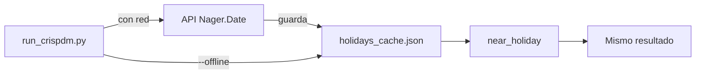

# :fontawesome-solid-rotate: Replicabilidad

!!! info "Requisito 4"
    Cualquier persona con Python 3.10+ puede reproducir **todo** el análisis
    CRISP-DM con un único comando, obteniendo exactamente los mismos resultados
    gracias a la semilla fija `RANDOM_SEED = 42`.

---

## Modos de reproducción

=== "1️⃣ Solo el análisis (5 minutos)"

    La forma más rápida. No necesita Docker, ni PostgreSQL, ni Django.

    ```bash
    # Clonar el repositorio
    git clone https://github.com/hectorpq/certybackend.git
    cd certybackend/SystemCertification/analytics

    # Instalar dependencias mínimas (pandas, sklearn, matplotlib...)
    pip install -r requirements-analytics.txt

    # Ejecutar el pipeline CRISP-DM completo
    python run_crispdm.py
    ```

    **Salidas generadas:**

    | Archivo | Descripción |
    |---|---|
    | `outputs/plots/01_target_distribution.png` | Distribución de asistencia |
    | `outputs/plots/02_attendance_by_category.png` | Asistencia por categoría |
    | `outputs/plots/03_attendance_by_holiday.png` | Efecto de los feriados |
    | `outputs/plots/04_feature_importances.png` | Importancia de variables |
    | `outputs/plots/05_confusion_matrix.png` | Matriz de confusión |
    | `outputs/plots/06_roc_curve.png` | Curva ROC del modelo ganador |
    | `outputs/metrics.json` | Métricas de los modelos |
    | `models/attendance_model.joblib` | Modelo serializado |

    **Resultado esperado (reproducible):**

    ```
    Modelo ganador: logistic_regression
    ROC-AUC: 0.806 | F1: 0.825 | CV-AUC: 0.764
    Meta (CV-AUC >= 0.75): ALCANZADA
    ```

=== "2️⃣ Sistema completo con Docker"

    Levanta el backend, frontend y base de datos con un solo comando.

    ```bash
    git clone https://github.com/hectorpq/certybackend.git
    cd certybackend/SystemCertification

    # Copiar variables de entorno de ejemplo
    cp .env.example .env

    # Levantar todos los servicios
    docker-compose up --build
    ```

    **Servicios iniciados:**

    | Servicio | Puerto | URL |
    |---|:---:|---|
    | Backend Django | 8000 | http://localhost:8000 |
    | API Docs (Swagger) | 8000 | http://localhost:8000/api/docs/ |
    | Frontend React | 3000 | http://localhost:3000 |
    | PostgreSQL | 5432 | — |
    | Redis | 6379 | — |

    Luego entrenar el modelo desde Django:
    ```bash
    docker-compose exec web python manage.py crispdm_train --synthetic
    ```

=== "3️⃣ Desarrollo local (sin Docker)"

    ```bash
    # Backend
    cd SystemCertification
    python -m venv .venv
    .venv\Scripts\activate   # Windows
    pip install -r requirements.txt

    # Configurar variables de entorno
    cp .env.example .env
    # Editar .env con tus credenciales de PostgreSQL

    python manage.py migrate
    python manage.py createsuperuser
    python manage.py runserver

    # En otra terminal: Frontend
    cd ../frontcerty
    npm install
    npm run dev
    ```

---

## Garantías de reproducibilidad

### Semilla fija

```python title="analytics/crispdm/config.py"
RANDOM_SEED = 42  # gobierna datos sintéticos Y entrenamiento del modelo
```

Esta semilla se pasa a:
- `numpy.random.default_rng(42)` → generación de datos sintéticos
- `LogisticRegression(random_state=42)` → inicialización del solver
- `RandomForestClassifier(random_state=42)` → construcción de árboles
- `train_test_split(..., random_state=42)` → partición de datos

### API de feriados con caché



Con `--offline` o si la API no responde, se usa la caché local → mismo resultado.

### Versiones fijadas

Todas las dependencias están con versión exacta en `requirements-analytics.txt`:

```text
pandas==2.1.3
numpy==1.26.4
scikit-learn==1.4.2
matplotlib==3.8.4
joblib==1.4.0
requests==2.32.3
```

---

## Verificación rápida de reproducibilidad

```bash
# Ejecutar dos veces y comparar métricas
python run_crispdm.py --offline
cat outputs/metrics.json | python -c "import sys,json;d=json.load(sys.stdin);print('AUC:', d['results']['logistic_regression']['roc_auc'])"
# → AUC: 0.806

python run_crispdm.py --offline   # segunda vez
cat outputs/metrics.json | python -c "import sys,json;d=json.load(sys.stdin);print('AUC:', d['results']['logistic_regression']['roc_auc'])"
# → AUC: 0.806  ← idéntico ✅
```

---

## Despliegue de esta documentación

Esta documentación está desplegada automáticamente en **GitHub Pages** (gratis)
cada vez que se hace `git push` a `main`:

```
https://hectorpq.github.io/certybackend/
```

El workflow de GitHub Actions en `.github/workflows/deploy-docs.yml` construye
el sitio con Material for MkDocs y lo publica en la rama `gh-pages`.

!!! tip "Para contribuir a la documentación"
    ```bash
    pip install mkdocs-material
    mkdocs serve   # preview en http://localhost:8000
    # editar archivos en docs/
    git push       # deploy automático
    ```
